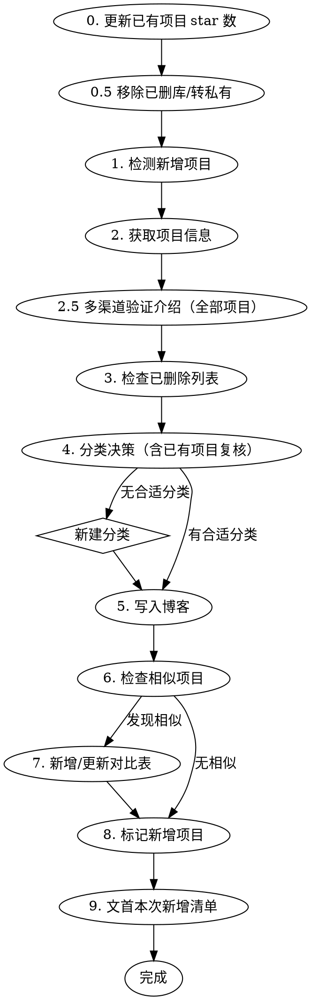

# 同步 GitHub Star 项目到博客

将用户 GitHub 新收藏的项目同步到 `source/_posts/项目收藏.md`，完成分类、写入和同类对比。

仓库内路径：`.agents/skills/sync-starred-projects/`（Agent Skills 规范位置，OMP `enableAgentsProject` / Codex 项目 skill / 本机 user junction 都指向这里）。Claude Code 从 `.claude/skills/sync-starred-projects/SKILL.md` 指针进入后读本文件。

## 流程



## Harness 与工具

机械步骤（star 实测、分页 starred、差集、易主检测）**先跑脚本**，不要手写循环或抽查：

```bash
HTTPS_PROXY= HTTP_PROXY= bun .agents/skills/sync-starred-projects/scripts/collect.mjs
```

PowerShell：`$env:HTTPS_PROXY=''; $env:HTTP_PROXY=''; bun .agents/skills/sync-starred-projects/scripts/collect.mjs`

完成标准：stdout 一份 JSON（`ok` / `blog` / `newStars` / `gone` / `goneNewStars` / `anchors` / `errors` / `skippedDeleted` / `skippedOwn`）。`blog[]` 覆盖博客里每一个 `github.com/owner/repo`，每条含 `apiStars`、`formatted`、`canonical`、`status`、`gone`。缺条就是没跑完。`anchors.broken` / `anchors.duplicated` 必须为空数组。

`ok` 必须为 `true`；为 `false` 时只看 `errors[]`（瞬时失败，重跑，不要带着 `apiStars: null` 往下走，那会被当成"star 没变"漏更新）。`gone[]` / `goneNewStars[]` 是 HTTP 404/451 的确定性结论，不进 `errors[]`，按第 0.5 步删除处理。脚本对 `gh api` 做 4 次退避重试，但对 404/451 不重试；每条 `gone` 命中后还会再确认一次，复查为瞬时失败也不会被误删。

`gh` 失败先清代理再试（本机失效代理常连 `127.0.0.1:7897`）：`HTTPS_PROXY= HTTP_PROXY= gh api ...`

取证按当前 harness 选**能直连的通道**，不要绑死某个产品的搜索工具名：

1. GitHub 元数据 / README → `gh api`（脚本已拉 description/homepage/topics；README 用 `gh api repos/{owner}/{repo}/readme -H "Accept: application/vnd.github.raw"`）
2. 已知 URL（homepage、文档站）→ 直接抓取（OMP `read` URL、Codex fetch、Claude WebFetch）
3. 需要关键词搜索 → 打开 `https://cn.bing.com/search?q=` 或当前 harness 可用且未耗尽配额的搜索。**本机 OMP 不要调用 `web_search`**（kimi 配额与对话共享，其余免登录引擎被墙）

## 0. 更新已有项目 star 数

以 `collect.mjs` 的 `blog[]` 为准：

1. 对每个项目把 `formatted`（API 实测格式化）和 `blogStars`（博客现值）并排比对，有差异就改博客。四舍五入到一位小数按真实数字算（50543 → 50.5k），不要凭旧值微调。
2. `renamed: true` → 博客链接改成 `canonical`，star 一并改，汇报里点名。
3. 引言「Star 数截至」改为当天。

除 star 数字和已易主链接外，本步不改项目名、描述。

## 0.5 移除已删库 / 转私有项目

`collect.mjs` 的 `gone[]` 列出博客里 API 返回 404/451 的仓库——已删库、转为私有或 DMCA 封禁。这类条目在博客里已经点不开，必须当轮移除，不留到以后：

1. 对 `gone[]` 每一条，整行删掉博客里对应的 bullet（含 `🆕 ` 前缀和结尾空行）。不挪到其他分类，不写"已失效"占位。
2. 该条目若出现在「同类项目对比」表格里：先看对比组里剩下的项目是否还够两个。剩两个及以上 → 删掉该列；只剩一个 → 删掉整组对比（`###` 标题 + 表格）。
3. 该项目的名称若出现在文首「本次新增」清单里 → 一起删掉。若因此清空，按第 9 步规则删整段。
4. 把 `owner/repo` 追加进 `references/deleted-projects.md`，注明原因（`删除` / `转私有` / `451`），避免它以后重新出现在 starred 列表时被当新项目加回来。
5. 汇报里单独列出本轮移除的项目和 HTTP 状态；`gone[]` 为空就明确写"无失效条目"。

`goneNewStars[]` 是候选新增里已消失的仓库，直接跳过，不进博客也不进 `deleted-projects.md`（它从未被收录）。

判定必须以脚本的复核后 `gone: true` 为准：网络错误、401、403 都不算消失，不要手动 curl 猜。

## 1. 检测新增项目

`collect.mjs` 已分页拉 `users/SpeechlessPanda/starred`（`per_page=100` 直到空页）并与博客做差集。

- 用户直接给了项目 URL → 跳过检测，用该项目（仍要跑脚本刷新已有 star）。
- `newStars[]` 即候选。`skippedOwn`（`SpeechlessPanda/*`）和 `skippedDeleted` 不入博客。
- **同一项目只收一条**：源码仓 + 发布仓（如 `x/blog-src` 与 `x/x.github.io`）只收源码仓；纯构建产物、站点镜像不入收藏，汇报时说明跳过原因。
- 无通用工具价值的仓库跳过并在汇报里点名：课程作业/竞赛报告、只有 PDF 产物、个人简历或私人工具。判据是"别人能不能拿它当工具或方法用"，star 数不作判据。

## 2. 获取项目信息

对每个新增项目，脚本已给出 `stargazers_count` / `description` / `homepage` / `topics`。description 空或含糊 → 再读 README 开头。

## 2.5 多渠道验证介绍（新增 + 已有全部项目）

验证范围是**博客里的所有项目**，不只本轮新增。只读 README 不够。每个项目至少交叉验证以下渠道中的两个；介绍里有具体数字/排名的要三个以上：

1. GitHub API 元数据（description、topics、homepage）—— description 为空必须读 README
2. README 正文
3. 项目官网（homepage）
4. 第三方来源（报道、评测、awesome 列表）——用上面的取证通道，子代理也必须实际抓取，不能只看喂给它的材料

**验证要点：**

- **数字类 claim 必须有出处**：如「300+ 助手」「减少 60-95% token」。找不到原文就改写成不含该数字。区分适用范围（Headroom 的 60-95% 只针对 JSON，编码代理场景约 15-20%）。
- **区分官方宣称与事实**：「基准测试最好」「事实标准」若只是官方自称，介绍里点明或弱化。
- **功能清单以现状为准**：以当前 README 的包/功能列表为准（Pi 的 Slack 机器人已拆到 `pi-chat`）。
- **复用已验证的事实**：本轮 README 已确认的（如 NapCat 推荐 SnowLuma）不必再派代理重复搜。
- 项目多则并行子代理按分类切分（每组 15–20 个），每项返回 `accurate` / `minor_fix` / `wrong` + 证据 URL + 修正要点。
- 介绍与事实不符 → 改该条目（核对修正），汇报里列出原因。

## 3. 检查已删除列表

权威列表：本 skill 的 [references/deleted-projects.md](references/deleted-projects.md)。再扫一遍当前 harness 的记忆（Claude `blog-deleted-projects`、OMP `memory://`、Codex memories）把多出来的名字合并进这份文件。命中则跳过并告知用户。

这份文件有两个来源：用户手动删除的项目，以及第 0.5 步因删库/转私有移除的项目（写在「仓库已消失」小节并注明日期与状态码）。两者都不再恢复。

## 4. 分类决策

读当前博客，按**实际用途**匹配已有 `` 分类，不按技术栈。

- 第 2.5 步发现归类错误 → 改介绍并挪分类（PaperX 是「论文 PDF → PPT/海报」，不是论文写作辅助）。汇报里说明。
- 都不贴 → **新建分类**：2–6 个中文字，插在逻辑相邻处，标题下写一句说明。
- 两个分类拿不准 → 读分类说明句，看用途。

除核对修正外不改已有内容。只追加新项目、新分类，或修正核实有误的条目。

## 5. 写入博客

```markdown
- [项目名](https://github.com/owner/repo) ⭐ {star数} — {一句话简介}。{解决的问题}。{亮点}。
```

star 格式与 `collect.mjs` 的 `formatted` 一致：`>=1000` → 一位小数 + `k`（47.0k、130.5k）；`<1000` → 原样数字。

简介：中文，2–3 句，是什么 → 解决什么 → 亮点。

插入：追加到所属分类末尾；与某条功能类似则相邻排。多个新项目处理完再一次性写入。写入前再读一遍博客文件。

### 页内锚点

每个 🆕 条目在 bullet 前加一个空 span，供文首「本次新增」跳转：

```markdown
- <span id="proj-fly-island"></span>🆕 [Fly Island](https://github.com/flyl1u/fly-island) ⭐ 798 — ...
```

- id 规则：`proj-` + 项目名小写，非字母数字折叠成单个 `-`（`Anti-Defensive Writing` → `proj-anti-defensive-writing`）。id 在全文唯一，旧条目的 span 不清除，保证历史链接可用。
- 折叠分类是 `<details>`，浏览器不会展开也不会滚进隐藏内容，配套脚本 `source/js/post-anchor.js` 负责展开祖先 `<details>`、按导航栏高度 71px 偏移滚动，并在 1.5s 内持续校准（字体/图片会改动上方高度）。脚本由 `_config.panda.yml` 的 `inject.bottom` 引入，带 `?v=N`；改了脚本必须递增版本号，否则浏览器继续跑旧文件。
- 站点侧已有 `#post #article-container [id^="proj-"] { scroll-margin-top: 71px; }`，改导航栏高度时两处一起改。

## 6–7. 相似项目与对比表

相似：同一类问题、用户可能二选一、功能重叠但各有特色。

博客末尾「同类项目对比」：已有组则加入；没有则新建。

```markdown
### {领域描述}：{项目A} vs {项目B}

| 维度 | {项目A} | {项目B} |
| --- | --- | --- |
| {维度1} | ... | ... |
| 适合人群 | ... | ... |
| 选择建议 | ... | ... |
```

分隔行 `| --- |`，单元格单空格，不强制列对齐。维度覆盖交互形式、核心能力、定位、扩展方式，最后一行明确选择建议。

## 8. 标记新增项目

1. 清旧标：bullet 上的 `- 🆕 [` → `- [`。只匹配这个模式，别动描述里的 emoji。
2. 本轮实际新写入的条目加 `🆕 `，并确认前面有 `<span id="proj-{slug}">`：`- <span id="proj-x"></span>🆕 [项目名](...)`。
3. 清旧标时保留旧 span，历史链接继续可用。

本轮没有新增则清完后整篇无 🆕，正常。

## 9. 文首本次新增清单

引言（blockquote）之后、`<!-- more -->` 之前，维护一段本轮新增项目名：

```markdown
本次新增：{项目名1}、{项目名2}、{项目名3}。
```

- 名字与 bullet 里 `[项目名]` 一致，顿号分隔，句号收尾
- 每个名字写成链接指向 bullet 前的 span；用**绝对 URL**（`https://speechlesspanda.github.io/2026/06/06/项目收藏/#proj-{slug}`），因为 Atom `<content>` 里的相对 `#` 链接在阅读器里会指错页面。slug 与第 5 步的 id 一致。
- 写完用一条命令校验：文首每个 `#proj-*` 都在正文有对应 `id`，且 id 无重复
- 覆盖上一轮这段，不累积历史
- 本轮零新增 → 删掉整段，不要留空「本次新增：」
- 必须在 `<!-- more -->` 之前，让首页摘要和 Atom `<summary>` 能带到

## 发表时间与 RSS

**禁止改 front-matter 的 `date`。** 本站 `permalink: :year/:month/:day/:title/`，改发表日会把 URL 从 `/2026/06/06/项目收藏/` 改成新日期路径，旧链接、Giscus（`data-mapping: pathname`）、既有 RSS `<id>` 全部失效。

Atom 由 Panda `node_modules/hexo-theme-panda/scripts/panda/feed.js` 写出，不靠改 `date` 推送：`updated_option: mtime`，保存文件即更新 `post.updated`；距发表超过 `feed.update_notify_hours`（默认 24h）会换新条目 id `{permalink}u/{timestamp}/` 并生成跳转 stub，阅读器当新条目推。

完成标准：`date:` 仍是原文发表时间；本轮有新增则文首有且仅有本轮项目名清单。

## 硬规则

- 核对修正（须汇报）：star 实测、易主链接、验证后的介绍改写、分类移动。
- 404/451 必删：脚本 `gone[]` 里的条目当轮从博客移除，并追加进 [references/deleted-projects.md](references/deleted-projects.md)。没有「保留失效链接」这个选项。
- 删条目要连带清理：同类对比表里该列（剩不足两个则删整组）、文首「本次新增」里的名字。
- `SpeechlessPanda/*` 不入收藏。
- 新增条目必须带 `proj-*` 锚点，文首清单用 `#proj-*` 链接；改 `source/js/post-anchor.js` 必须同步递增 `_config.panda.yml` 里的 `?v=`。同名 id 只能出现一次。
- 已删除列表里的不恢复。
- 脚本 JSON 是 star/差集的唯一数字来源；禁止沿用博客旧值或凭印象估算。
- 新增条目的 star 用脚本 `formatted`，不要用后续 `gh api` 的更新值——同一次同步里数字必须自洽。
- 仓库改名（`renamed: true`）时链接改 `canonical`，条目名与描述同时按新定位重写；改名后业务性质变了（如 HTML 编辑器变成视频工具）要重写介绍，不能只换 URL。
- 禁止改 `date:`。
